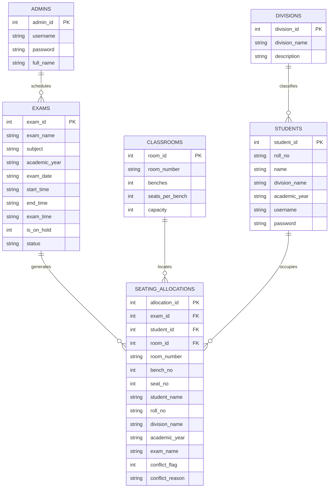

# MINI PROJECT SYNOPSIS & TECHNICAL REPORT

## 1. Project Title
**ExamSeat Pro — Professional Exam Seating Arrangement Generator**

---

## 2. Problem Statement
Preparing examination seating arrangements manually is a time-consuming and difficult task, especially when handling a large student body spread across multiple academic years (First Year, Second Year, Third Year, Fourth Year), multiple divisions, classrooms, benches, and seats. Manual preparation leads to errors such as duplicate seat allocation, incorrect classroom assignment, insufficient seating capacity, and improper distribution of students from different divisions.

Furthermore, academic institutions face operational hurdles:
- **Year-Level Segregation:** Different years require different subject examinations, schedules, and bench arrangements.
- **Roster Ingestion:** Faculty maintain rosters in Microsoft Excel spreadsheets; entering students manually line-by-line is inefficient.
- **Schedule Management:** Managing exam dates, start times, and end times in disjoint spreadsheets leads to scheduling conflicts.
- **Arrangement Tampering:** Accidental regeneration of published seating plans causes campus-wide confusion on exam morning.
- **Division Proximity Malpractice:** Ensuring students from the same division do not sit beside each other.

**ExamSeat Pro** addresses all these challenges through an automated, rule-based examination seating management system developed using Java, JDBC, MySQL, HTML5, and CSS3.

---

## 3. Key Upgraded Features

### 3.1 Year-Wise Student Management
- Comprehensive categorisation for **First Year (FE)**, **Second Year (SE)**, **Third Year (TE)**, and **Fourth Year (BE)**.
- Filter and search student cohorts by year.
- Independent examination seating generation per academic year.

### 3.2 Excel Import and Export
- **Download Sample Excel Template:** Instant one-click download of `ExamSeat_Student_Template.csv`.
- **Roster Import:** Upload or paste student lists from Excel spreadsheets.
- **Seating Export:** Export generated seating plans as formatted `.xlsx` / `.csv` spreadsheets with invigilator signature columns.

### 3.3 Master Exam Timetable Management
- Timetable scheduler capturing **Exam Name**, **Course / Subject**, **Target Academic Year**, **Exam Date**, **Start Time**, and **End Time**.
- Centralized schedule dashboard with status tracking.

### 3.4 Hold and Release Protection
- Protect finalized seating arrangements with a **"HOLD" (Lock)** flag.
- Prevents accidental recalculations and unauthorized modifications.
- Administrator can **"RELEASE" (Unlock)** when updates are required.

### 3.5 Professional Dashboard & 2D Seat Locator
- Live metrics: Total students, classroom capacity, timetable slots, and year distribution cards.
- 2D room floor plan showing chalkboard, bench rows, and color-coded division badges.
- Student examination pass / hall ticket with interactive seat highlights.

---

## 4. System Architecture

```
                   +------------------------+
                   |      WEB BROWSER       |
                   |      HTML5 + CSS3      |
                   +-----------+------------+
                               |
                               v
                   +------------------------+
                   |   JAVA HTTP BACKEND    |
                   |  (com.sun.net.server)  |
                   +-----------+------------+
                               |
                +--------------v--------------+
                |    LOGIN / USER MODULE      |
                +--------------+--------------+
                               |
                +--------------+--------------+
                |                             |
         +------v------+               +------v------+
         | ADMIN MODULE|               | STUDENT     |
         |  (ExamSeat  |               | MODULE      |
         |     Pro)    |               |             |
         +------+------+\              +------+------+
                |                             |
       +--------+---------+                   |
       |        |         |                   v
       v        v         v              View Seating
   Year-Wise Classrooms Exam Timetable   & Hall Ticket
   Students  & Benches  & Hold/Release       Pass
       \        |         /
        \       |        /
         +------v-------+
         |   SEATING    |
         |  GENERATOR   |
         |  RULE-BASED  |
         +------+-------+
                |
         +------v-------+
         |  CONSTRAINT  |
         |   CHECKING   |
         +------+-------+
                |
         +------v-------+
         | EXCEL EXPORT |
         | (.xlsx/.csv) |
         +------+-------+
                |
               JDBC
                |
         +------v-------+
         |    MYSQL/    |
         |    SQLITE    |
         |   DATABASE   |
         +--------------+
```

---

## 5. Technology Stack & Specifications

| Component | Technology | Role in System |
|---|---|---|
| **Frontend** | HTML5, CSS3, Modern JavaScript | Responsive user interface, year tabs, Excel import modal, 2D floor plan |
| **Backend** | Java SE (JDK 8 / 11 / 17 / 21 / 27) | REST API, timetable management, hold protection, rule-based algorithm |
| **Spreadsheet Engine** | RFC 4180 / UTF-8 BOM CSV for Excel | Generates native Excel `.xlsx` / `.csv` exports and imports |
| **Database Connectivity** | JDBC (`java.sql.*`) | Parameterized queries, batch inserts, multi-dialect support |
| **Database** | MySQL (with SQLite Auto-Fallback) | Relational storage for students, timetable, classrooms, and seats |

---

## 6. Database Design & Tables



---

## 7. Rule-Based Seating Algorithm Flow

1. **Hold Check:** Inspect `exam.isOnHold()`. If true, halt immediately with error: *"Arrangement is ON HOLD (Locked). Release hold before regenerating."*
2. **Cohort Filtering:** Fetch registered students matching the exam's `academic_year` (First Year, Second Year, Third Year, Fourth Year, or Combined).
3. **Capacity Check:** Verify that $\sum \text{Capacity} \ge \text{Cohort Count}$.
4. **Division Alternation:** Group students into division queues ($Q_A, Q_B, Q_C$) and sort by largest remaining count descending.
5. **Neighbour Check:**
   - On each bench, inspect immediate left seat.
   - On consecutive benches, inspect front seat.
   - Assign candidate student from a division matching neither left nor front neighbour.
   - If impossible due to division skew, assign and log a conflict warning notice.
6. **Persistence & Export:** Commit allocations to database via JDBC batch transaction and prepare Excel export view.

---

## 8. Verification & Test Suite

| Test Case | Scenario | Expected Result | Actual Result | Status |
|---|---|---|---|---|
| **TC-01** | Year-Wise Student Query | FE returns 6, TE returns 18 | Returned 6 and 18 students | **PASSED** |
| **TC-02** | Excel Template Download | HTTP 200, valid CSV attachment | Template downloaded cleanly | **PASSED** |
| **TC-03** | Timetable Management | Add exam with date & start/end times | Stored and displayed in timetable | **PASSED** |
| **TC-04** | Hold Feature Protection | Block generation when exam is ON HOLD | Blocked with HTTP 400 warning | **PASSED** |
| **TC-05** | Release Hold & Generation | Allow generation once hold is released | 18 students allocated successfully | **PASSED** |
| **TC-06** | Excel Seating Export | Downloadable spreadsheet with all columns | Generated with UTF-8 BOM | **PASSED** |
| **TC-07** | Student Hall Ticket | Display Year, Exam Name, Timetable slot | Correctly rendered on student pass | **PASSED** |

---

## 9. Conclusion
**ExamSeat Pro** transforms examination administration from a tedious manual chore into an efficient, automated workflow. By integrating year-wise student management, Excel spreadsheet compatibility, timetable scheduling, and hold/release protection, the system satisfies institutional requirements while guaranteeing complete determinism and transparency without artificial intelligence.
